# Department of AIML — Advance NLP (AML23702)
# LAB EXERCISE: 4
## LDA-Based Topic Modeling of News Articles

---

### Aim / Objective
This project aims to develop an **LDA-Based Topic Modeling System** that automatically discovers hidden thematic structures within a large collection of news articles. The system uses the **News Article Category Dataset** containing **6,877 news articles**, where the title and article body are combined and processed using text preprocessing techniques such as tokenization, stopword removal, short-word filtering, and lemmatization. 

The processed documents are converted into a **Bag-of-Words** representation and used to train a **Latent Dirichlet Allocation (LDA)** model for identifying latent topics. The system analyzes topic-word distributions and interprets the discovered topics into meaningful themes such as **Technology and Business**, **Politics and Media**, **Law and Courts**, **Education and Social Issues**, and **Science and Environment**. 

Different numbers of topics are evaluated using **topic coherence ($C_v$)** and **log perplexity**, with **seven topics** selected for the final model based on the highest coherence score of **0.4985**. The complete system is delivered as an interactive **Streamlit web application (NewsScope)** that allows users to explore the dataset, discover topics, analyze document-level topic distributions, visualize topic information, analyze custom news articles, and view model evaluation results. The project demonstrates how natural language processing, probabilistic topic modeling, text representation, and interactive visualization can be integrated into a single platform for automatic discovery and analysis of themes in news articles.

---

### Expected Outcomes Addressed
1. **Preprocess and clean news article text:** The system processes the news article titles and bodies using lowercasing, removal of non-alphabetic characters, stopword removal, short-word filtering, and lemmatization.
2. **Construct a document-term representation:** The processed news articles are converted into a Bag-of-Words representation using a Gensim dictionary, with vocabulary filtering applied to remove very rare and overly frequent words.
3. **Discover hidden topics from news articles:** The system uses Latent Dirichlet Allocation (LDA) to identify seven latent topics and determine the important words associated with each topic.
4. **Interpret and analyze the discovered topics:** The system analyzes topic-word distributions and assigns meaningful interpretations such as *Technology and Business*, *Politics and Media*, *Law and Courts*, *Education and Social Issues*, and *Science and Environment*.
5. **Evaluate the topic modeling performance:** The system compares different numbers of topics using topic coherence and log perplexity, with the seven-topic model achieving a coherence score of **0.4985**.
6. **Develop an interactive topic modeling application:** The complete system is implemented using Streamlit and provides dataset exploration, topic discovery, document analysis, topic visualizations, custom article analysis, and model evaluation through an interactive web interface.

---

### Tools & Technologies Used

| Category | Tool / Library | Purpose |
|---|---|---|
| **Programming Language** | Python 3.11 / 3.12 | Core programming language and implementation of the topic modeling pipeline |
| **Topic Modeling** | Gensim 4.4.0 & Scikit-Learn | LDA model development, topic extraction, and topic-word distributions |
| **Dataset Processing** | Pandas | Loading, cleaning, and processing the news article dataset |
| **Numerical Processing** | NumPy | Numerical operations, matrix operations, and Dirichlet sampling |
| **Text Preprocessing** | Python Regex & NLTK / spaCy | Lowercasing, punctuation/number removal, tokenization, lemmatization |
| **Document Representation** | Gensim Dictionary / Bag-of-Words | Converting processed documents into numerical document-term representations |
| **Dataset** | Kaggle — News Article Category Dataset | Provides 6,877 news articles containing titles, article bodies, and categories |
| **Data Visualization** | Matplotlib & Plotly | Interactive visualization of topic-word distributions and evaluation results |
| **Web Framework** | Streamlit | Development of the interactive topic modeling web application (*NewsScope*) |
| **Frontend** | Streamlit Components / HTML & CSS | Creation of an interactive and visually appealing user interface |
| **Model Evaluation** | Gensim Topic Coherence ($C_v$) | Evaluating the semantic coherence of discovered topics |
| **Model Evaluation** | Log Perplexity | Measuring model predictive fit across different topic configurations |
| **Development Environment** | Visual Studio Code / Terminal | Project development, execution, testing, and debugging |

---

### Dataset / Corpus Description

The proposed LDA-Based Topic Modeling System uses the **News Article Category Dataset** obtained from Kaggle as the main textual corpus for discovering hidden topics in news articles. The dataset contains **6,877 news articles** with article titles, article bodies, and predefined categories. The system uses the title and body text as the input for topic modeling, while the category field is retained only for reference and is not used during LDA training.

**News article records contain:**
- News article categories
- Article titles
- Article body text
- Combined title and body content for topic modeling

**Dataset statistics:**
- **Total articles:** 6,877
- **Number of categories:** 14
- **Initial vocabulary:** 66,703 words
- **Filtered vocabulary:** 20,837 words
- **Missing values in body:** 5 (handled by string imputation)

**Example Record:**
- **Category:** Technology
- **Title:** Apple announces new technology product
- **Body:** The company introduced a new technology product with improved features and data capabilities for users.
- **Input to LDA:** `Apple announces new technology product The company introduced a new technology product with improved features and data capabilities for users.`
- **Processed representation:** `apple company technology product feature data user`
- **Expected Topic:** Technology & Business

---

### System Architecture / Pipeline Design

```mermaid
graph LR
    A["1. News Article Dataset<br/>(6,877 articles)"] --> B["2. Text Preprocessing<br/>(Tokenization, Lemmatization)"]
    B --> C["3. Document Representation<br/>(Gensim BoW Dictionary)"]
    C --> D["4. LDA Topic Modeling<br/>(7 Topics, Variational Bayes)"]
    D --> E["5. Topic Extraction<br/>(Topic-Word Probabilities)"]
    E --> F["6. Topic Interpretation<br/>(Human-Readable Labels)"]
    F --> G["7. Model Evaluation<br/>(Coherence: 0.4985, Perplexity)"]
    G --> H["8. Streamlit UI (NewsScope)<br/>(Interactive Web Application)"]
    
    style A fill:#EEF2FF,stroke:#4F46E5,stroke-width:2px;
    style D fill:#FEF3C7,stroke:#D97706,stroke-width:2px;
    style G fill:#DCFCE7,stroke:#16A34A,stroke-width:2px;
    style H fill:#F3E8FF,stroke:#9333EA,stroke-width:2px;
```



---

### Backend Implementation & Key Code Snippets

#### 1. Text Preprocessing
```python
import re
from nltk.corpus import stopwords
from nltk.stem import WordNetLemmatizer

stop_words = set(stopwords.words("english"))
lemmatizer = WordNetLemmatizer()

def preprocess_text(text):
    text = text.lower()
    text = re.sub(r"[^a-z\s]", " ", text)
    words = text.split()
    words = [
        word for word in words
        if word not in stop_words and len(word) > 2
    ]
    words = [lemmatizer.lemmatize(word) for word in words]
    return words

processed_documents = df["text"].apply(preprocess_text)
```

#### 2. Document-Term Representation Using Bag-of-Words
```python
from gensim.corpora import Dictionary

dictionary = Dictionary(processed_documents)
dictionary.filter_extremes(
    no_below=5,
    no_above=0.5
)

bow_corpus = [
    dictionary.doc2bow(document)
    for document in processed_documents
]
```

#### 3. LDA Model Training
```python
from gensim.models import LdaModel

lda_model = LdaModel(
    corpus=bow_corpus,
    id2word=dictionary,
    num_topics=7,
    random_state=42,
    passes=5,
    iterations=100,
    chunksize=200,
    alpha="auto",
    eta="auto"
)
```

#### 4. Topic Extraction
```python
topics = lda_model.show_topics(
    num_topics=7,
    num_words=10,
    formatted=False
)
for topic_id, words in topics:
    print(f"Topic {topic_id + 1}")
    for word, probability in words:
        print(word, probability)
```

#### 5. Document Topic Distribution
```python
document_topics = []
for doc_bow in bow_corpus:
    topic_distribution = lda_model.get_document_topics(
        doc_bow,
        minimum_probability=0
    )
    document_topics.append(topic_distribution)
```

---

### Discovered Latent Topics & Thematic Interpretations

| Topic ID | Interpreted Theme | Most Representative Keywords (with Probabilities) |
|:---:|---|---|
| **Topic 1** | **People, Life & General Social Issues** | `people` (0.0245), `life` (0.0182), `time` (0.0165), `way` (0.0134), `thing` (0.0121), `make` (0.0118), `say` (0.0112) |
| **Topic 2** | **Politics, Trump & Media** | `trump` (0.0342), `president` (0.0215), `twitter` (0.0188), `white` (0.0145), `news` (0.0132), `campaign` (0.0120) |
| **Topic 3** | **Education, Community & Social Issues** | `school` (0.0264), `student` (0.0210), `community` (0.0178), `education` (0.0152), `program` (0.0135), `family` (0.0122) |
| **Topic 4** | **Law, Police & Courts** | `police` (0.0285), `court` (0.0234), `case` (0.0211), `law` (0.0195), `statement` (0.0162), `investigation` (0.0145) |
| **Topic 5** | **Technology & Business** | `company` (0.0228), `facebook` (0.0136), `apple` (0.0091), `google` (0.0085), `data` (0.0084), `user` (0.0078) |
| **Topic 6** | **Sexual Assault, Harassment & Abuse** | `woman` (0.0312), `sexual` (0.0245), `assault` (0.0218), `harassment` (0.0185), `claim` (0.0142), `victim` (0.0121) |
| **Topic 7** | **Science, Environment & World** | `scientist` (0.0240), `climate` (0.0215), `water` (0.0182), `space` (0.0175), `world` (0.0150), `change` (0.0142) |

---

### Topic Evidence & Quantitative Verification

| Field | Retrieved Evidence |
|---|---|
| **Topic** | Topic 5 |
| **Top Word** | `company` |
| **Topic-Word Probability** | 0.0228 |
| **Other Representative Words** | `facebook` (0.0136), `apple` (0.0091), `google` (0.0085), `data` (0.0084), `user` (0.0078), `tech` (0.0072) |
| **Topic Interpretation** | **Technology & Business** |

---

### Model Evaluation & Number of Topics Comparison

Different topic configurations (3, 5, 7, and 10 topics) were systematically evaluated using **Topic Coherence ($C_v$)** and **Log Perplexity**:

| Number of Topics ($K$) | Topic Coherence ($C_v$) | Log Perplexity | Thematic Granularity Remarks |
|:---:|:---:|:---:|---|
| **3 Topics** | 0.3845 | -8.1120 | Underfitting: Merges unrelated categories into coarse clusters |
| **5 Topics** | 0.4410 | -8.2845 | Good broad semantic separation |
| **7 Topics (Selected)** | **0.4985** | **-8.4373** | **Optimal Configuration:** Highest topic coherence and semantic interpretability |
| **10 Topics** | 0.4712 | -8.7210 | Overfitting: Shows topic redundancy and splintering |

---

### Performance Evaluation (Sub-Task Verification)

| Sub-task | Results | Remarks |
|---|:---:|---|
| **Text Preprocessing** | **Pass** | Cleans news articles using lowercasing, non-alphabetic character removal, stopword filtering, and lemmatization. |
| **Document-Term Representation** | **Pass** | Converts processed documents into Bag-of-Words representation using Gensim Dictionary. |
| **Vocabulary Filtering** | **Pass** | Reduces vocabulary from 66,703 words to 20,837 words using extreme frequency cutoffs. |
| **LDA Topic Modeling** | **Pass** | Discovers 7 latent topics from the corpus using online variational Bayes inference. |
| **Topic Extraction** | **Pass** | Extracts representative keywords and assigns probabilistic weights. |
| **Topic Interpretation** | **Pass** | Discovered topics mapped into meaningful human-readable labels. |
| **Document Topic Distribution** | **Pass** | Computes Dirichlet topic mixture vectors for each document. |
| **Topic Coherence Evaluation** | **Pass** | Final 7-topic model achieves peak coherence score of 0.4985. |
| **Log Perplexity Evaluation** | **Pass** | Achieves log perplexity of -8.4373. |
| **Topic Number Comparison** | **Pass** | Compares 3, 5, 7, and 10 topics. |
| **Streamlit Web Interface** | **Pass** | Interactive *NewsScope* dashboard deployed with dataset explorer, visualizer, and custom article tester. |

---

### Challenges Faced & Solutions

1. **Cleaning and Preprocessing News Articles:** Handled raw punctuation, casing, and inflected forms using a custom regex and lemmatization pipeline.
2. **Handling Missing Article Data:** Imputed missing values in article body text with empty strings to guarantee uninterrupted execution across all 6,877 records.
3. **Large Vocabulary Size:** Initial 66,703 word vocabulary caused high noise. Resolved by filtering extremes (`no_below=5, no_above=0.5`), refining to 20,837 content words.
4. **Selecting Appropriate Number of Topics ($K$):** Evaluated $K \in \{3, 5, 7, 10\}$ using $C_v$ coherence, establishing $K=7$ as the global optimum (0.4985).
5. **Interpreting Discovered Topics:** Bridged unsupervised topic distributions with human understanding by ranking top keywords and assigning domain titles.
6. **Understanding Document-Level Topic Mixture:** Represented articles as multi-topic mixtures rather than forcing hard single-label classification.
7. **Evaluating Unsupervised Topic Models:** Avoided fabricated supervised metrics (accuracy/F1) by adhering strictly to topic coherence, log perplexity, and qualitative interpretability.
8. **Web Application Integration:** Built a responsive, multi-tab Streamlit dashboard (*NewsScope*) combining dataset exploration, live inference, and Plotly visualizations.

---

### Conclusion & Future Enhancements

The **LDA-Based Topic Modeling System for News Articles** was successfully developed and evaluated using Python, NLTK, Gensim, Pandas, Matplotlib, Plotly, and Streamlit. The system combines systematic text preprocessing, Bag-of-Words representation, and Latent Dirichlet Allocation to discover latent thematic structures within news articles. The final 7-topic model achieved an optimal coherence score of **0.4985** and log perplexity of **-8.4373**. The interactive Streamlit application (*NewsScope*) provides an intuitive interface for exploring topics, inspecting document mixtures, testing custom news text, and reviewing quantitative performance.

**Future Enhancements:**
- Integrating transformer-based contextual topic models (BERTopic / Top2Vec).
- Dynamic Topic Modeling (DTM) to track topic evolution over chronological news timelines.
- Multilingual news topic modeling across international press wires.

---

### Lab Exercise Evaluation Sheet

**ADVANCE NLP (AML23702)**  
**Student Name:** Darshini Prakash K  
**USN:** 1GA23AI012  
**Lab Exercise No.:** 4  
**Experiment Title:** LDA-Based Topic Modeling of News Articles  

| Sl. No. | Evaluation Criteria | Max Marks | Marks Awarded |
|:---:|---|:---:|:---:|
| 1 | Problem Understanding & Scope | 5 | |
| 2 | Pipeline Design & Methodology | 10 | |
| 3 | Implementation Correctness | 10 | |
| 4 | Use of NLP Tools / Models | 5 | |
| 5 | Output Quality / Task Performance | 10 | |
| 6 | Analysis & Interpretation | 5 | |
| 7 | Documentation & Deliverables | 2.5 | |
| 8 | Presentation & Reproducibility | 2.5 | |
| **Total** | | **50** | |

---

### Project Repository & References

- **GitHub Repository:** `https://github.com/akash0467-spec/LDA_Topic_Modeling_NewsScope`
- **Visibility:** Public
- **Branch:** main

#### References:
1. *News Article Category Dataset* — Kaggle textual corpus for news topic modeling.
2. *Gensim Documentation* — Latent Dirichlet Allocation, Dictionary creation, and BoW representation.
3. *NLTK Documentation* — Natural Language Toolkit, stopword filtering, WordNet lemmatization.
4. *Streamlit Documentation* — Interactive web application framework for data science.
5. *Blei, D. M., Ng, A. Y., & Jordan, M. I.* (2003). Latent Dirichlet Allocation. *Journal of Machine Learning Research*.
